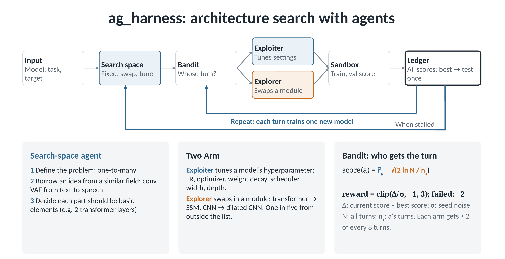

# ag_harness

**An agent loop that searches architectures for your model until it reaches a target score.** You bring a working model, its data, a scoring function and a target number. Claude agents propose new architectures and training settings. The harness trains and scores each one in a sandbox, and the scores decide what to try next. At the end, the best model is retrained and scored once on your test split.

We validated it by reproducing published models from their base architectures, with the agents given only the paper's number ([results](#validation)).

## How it works

1. **Input:** your base model, a task description, the data loader and scorer, and the target.
2. **Search-space agent:** decides which modules stay fixed, which get swapped and which settings get tuned. It can search the web.
3. **Bandit:** picks whose turn it is. Each turn trains one new model.
   - **Exploiter:** tunes a top model's settings (learning rate, weight decay, width).
   - **Explorer:** swaps in a module, e.g. concatenation → FiLM, or CNN → dilated CNN.
4. **Sandbox:** trains the candidate and scores it on val. Agent code never runs outside the sandbox.
5. **Ledger:** records every candidate and score. The loop calls the search-space agent again when progress stalls or the space is mostly tried.
6. **Finalize:** retrains the best val model, scores test once, and writes `final.json` and `best/`.

The loop itself is plain Python (`harness/driver.py`). Agents write only search spaces and model code, and each call is a fresh `claude -p` session that sees only its own run. Before each call, the loop writes the agent a summary of the run so far; `.claude/agent-memory/` specifies what goes into it.

## Quick start

    harness/bin/setup.sh                       # once per server: .venv, packages, then `agh doctor`
    harness/bin/agh new-case my_model          # copies cases/_template → cases/my_model/
    # edit cases/my_model/: data_loader.py, base/model.py, base/train_config.py, task.md, budget.yaml
    harness/bin/agh check-case my_model        # size check + short training + time estimate (no agents)
    harness/bin/agh init-run my_model r1
    nohup harness/bin/agh loop my_model r1 > runs/my_model/r1/loop.log 2>&1 &

When the loop finishes, `runs/my_model/r1/final.json` has the test score and the ratio to target. `best/` has the winning code and the command to rerun it. To see what changed, run `diff runs/my_model/r1/cands/000/model.py runs/my_model/r1/best/model.py`.

- **Try it first:** the template runs as is, using a toy sequence model with a context input. Run the commands once unchanged, then replace the toy parts with your own.
- **No free GPU:** prefix any command with `AGH_DEVICE=cpu`.
- **Steer a running search:** write instructions into `runs/<case>/<run>/steer.md`, e.g. "stop trying attention". Every later agent call sees them.
- **Constraints:** list them under `notes_for_agents` in `budget.yaml`, e.g. "keep the encoder".
- **Requirements:**
  - Linux, with an NVIDIA GPU or `AGH_DEVICE=cpu`
  - `bwrap` (bubblewrap)
  - Python 3.10 or newer
  - Claude Code installed and logged in

For the file contract, all `budget.yaml` keys, the commands and the run-folder layout, see [docs/USAGE.md](docs/USAGE.md).

## Cost

Each candidate takes one agent call (1–5 min, about $0.3 with Opus) plus one training run. A 30-candidate run costs about $10 in agent calls, plus 30 × your training time. `check-case` prints an estimate.

## Validation

Each search started from the paper's base model and was given only the paper's number, never the paper itself. Both columns are test scores; the reproduced scores come from the model the search picked, trained once.

| Paper | Task | Paper's performance | Reproduced performance |
|---|---|---|---|
| XChrom | Peak accessibility for unseen cells from their RNA | auROC 0.83 | 0.828, 0.824, 0.825 (3 runs) |
| ZEN | Zero-shot neural decoding of unseen mice | 0.437 | 0.426 |
| scooby | Single-cell RNA coverage from a cell embedding | Pearson 0.501 | 0.474 |

The validation data are lab-internal and not part of this repository.

## Limitations

- **Results can differ from run to run.** In the validation cases, the search found architectures that reach the target score. But the agents are LLMs, so each run can take a different path and end with a different architecture and score. Do not rely on a single run; run it several times (`harness/bin/chain.sh`).
- **The explorer can be under-used.** In the scooby run, the explorer's first candidate scored poorly, and the bandit then gave every remaining turn to the exploiter. That run only tuned the base model's settings and never tried a new module. Each agent now gets at least 2 of every 8 turns, but check the agent column in `LEDGER.md` to make sure modules were actually tried.
- **Reward hacking is a risk.** Agents optimise the score they are given, so a gap in the evaluation can raise the score without a better model. In the ZEN case, candidates normalised over the test trials evaluated together in one batch and scored 1.21 × the paper; we closed the gap by evaluating one trial at a time and discarded those runs. Keep `EVAL_BATCH = 1`, and read the winning code in `best/` before trusting a number.

## Contributors

- [wns823](https://github.com/wns823) (SJYang)
- Claude (Anthropic), via Claude Code: co-authored the code and documentation
